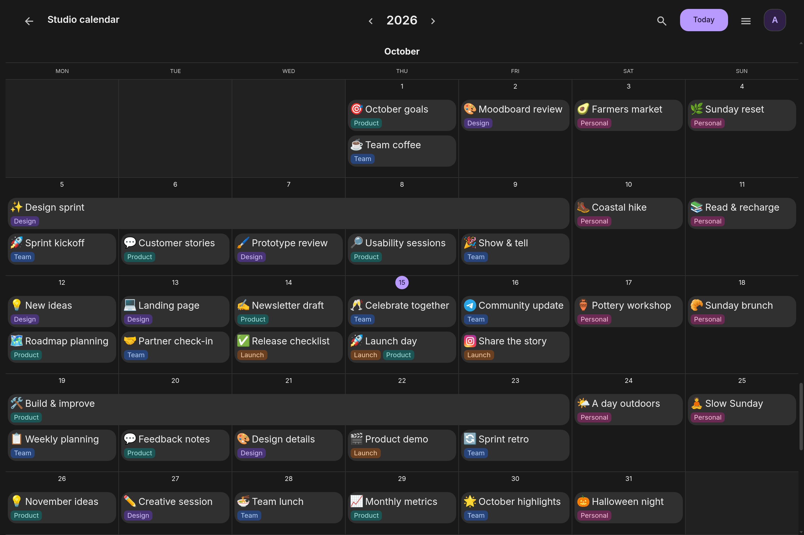
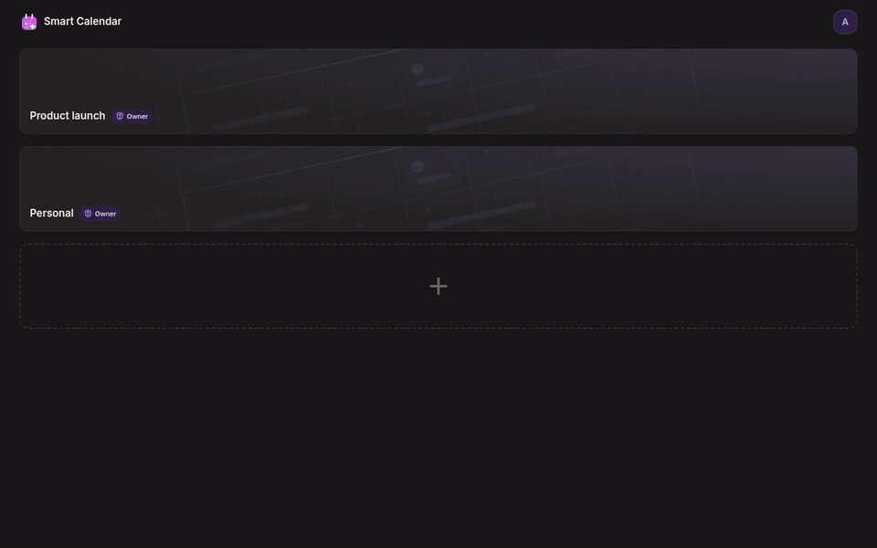
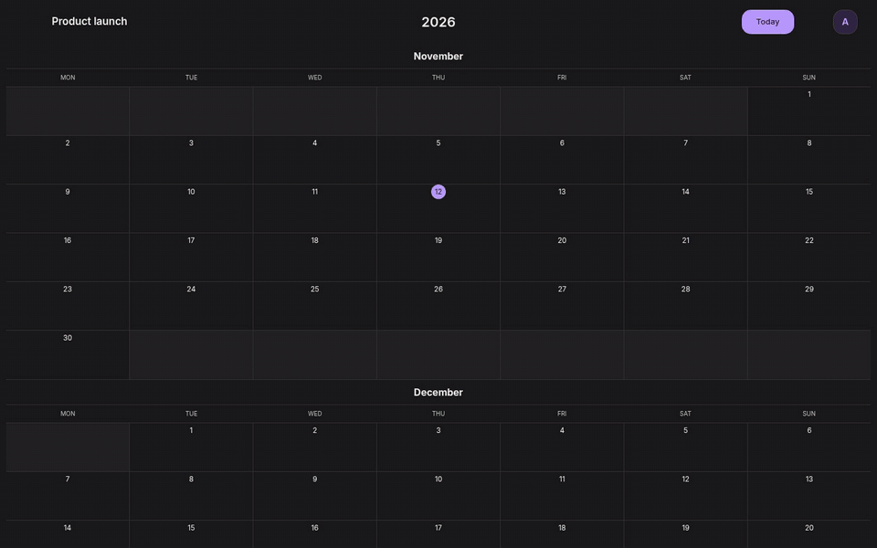
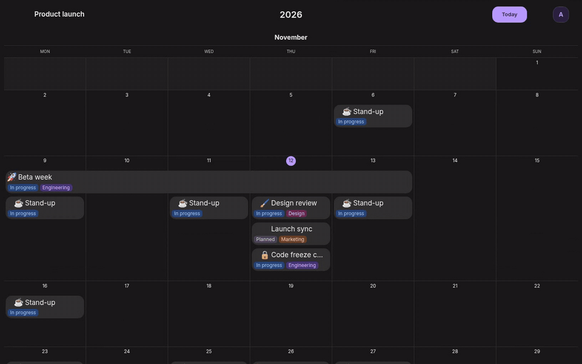
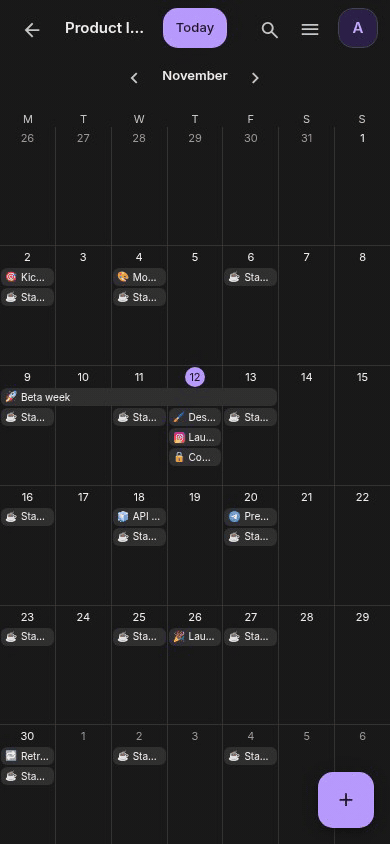
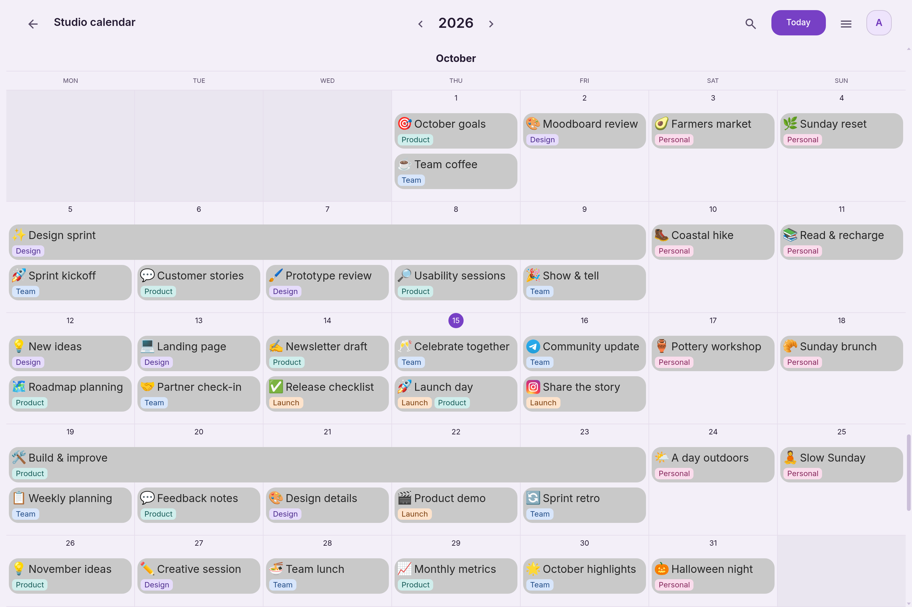
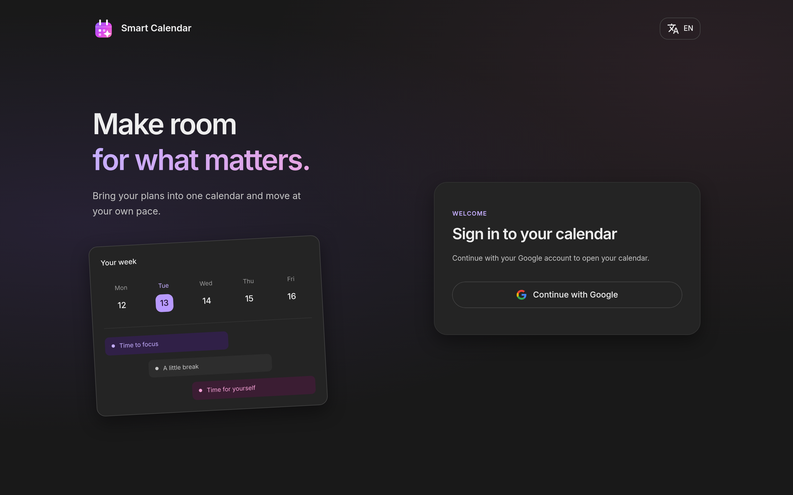

# Smart Calendar

**Plan the whole year, not just the week.** A calm, Notion-style calendar for small teams and couples: one scrolling year, events with icons and colored tags, and sharing in a single link.

<picture>
  <source media="(prefers-color-scheme: dark)" srcset="docs/images/calendar-dark.png">
  <source media="(prefers-color-scheme: light)" srcset="docs/images/calendar-light.png">
  
</picture>

_Example calendar with fictional events._

## Highlights

- **One calendar for everything.** The year scrolls month by month and every week grows to fit its events.
- **Events that look like yours.** An emoji, a brand logo or any image as the icon, tags grouped into categories.
- **Fast to edit.** Everything autosaves, drag to reschedule, drag to the trash to delete, undo in one tap.
- **Made for sharing.** Several calendars, roles for every member, one-time invite links.
- **Everywhere.** Light and dark themes, English, Russian and Spanish, a phone layout and an installable PWA.
- **Private by design.** Sign in with Google only, no passwords to store or leak.

## Create calendars and events

Make a calendar, name it right on the page, and click a day to add an event. The dialog saves as you type: title, description, icon, dates, time, repeat rule and a done mark.



## Tags, drag and drop, delete

Group tags into categories, create them on the spot and give each one a color. Move an event to another day by dragging it, or drop it on the trash zone to delete it. A short undo brings it back.



## Recurring events

Repeat daily, weekly, monthly or yearly, with an end date or a number of repetitions. When you edit a series, choose what changes: this event, this and the following events, or all of them, just like in Google Calendar.

## Search and archive

Find any event by title, description or tag. Nothing is lost by accident: deleted events wait in the archive until you restore them or remove them for good.



## Share a calendar

Invite someone with a one-time link that expires in 7 days. Pick a role first, editor or viewer; the owner keeps control of members and links.


## Export to Excel

Download the events of any period of up to a year as an `.xlsx` file, with a column for every tag category.

## On your phone

Smart Calendar is a PWA: add it to your home screen and it opens like a native app. The year turns into a month grid, a tap on a day opens an hourly scale like in Google Calendar, a hold moves an event in time and its bottom handle makes it longer. Swipe left or right to change the day.

<p align="center">
  
</p>

## Themes and languages

Light and dark themes that follow your taste, and an interface in English, Russian and Spanish. The language follows your browser until you choose one.

<p align="center">
  
  
</p>

## Stack

| Part     | Technologies                                                                |
| -------- | --------------------------------------------------------------------------- |
| Frontend | Angular (standalone, signals), Angular Material, FullCalendar v7, Transloco |
| Backend  | NestJS, Prisma 7, class-validator, Swagger, google-auth-library             |
| Database | PostgreSQL                                                                  |
| Infra    | Docker Compose, Caddy, external HTTPS reverse proxy, GitHub Actions CI      |

Sessions are stored in the database and sent as an httpOnly cookie. The frontend and the API share one domain, the API lives under `/api`.

## Repository layout

```
apps/
  frontend/   Angular app, Dockerfile and Caddyfile for production
  backend/    NestJS API, Prisma schema and migrations
docs/         architecture, domain rules, API, and deployment guides in English
docker-compose.yaml        Postgres for local development
docker-compose.prod.yaml   production: Postgres, migrations, API, Caddy
```

There are no npm workspaces: each app has its own `package.json` and `node_modules`. The root `package.json` holds only the shared tooling (ESLint, Prettier) and wrapper scripts.

## Getting started

Requirements: Node.js 24, Docker with the compose plugin, and a Google OAuth client ID of type "Web application" with `http://localhost` and `http://localhost:4200` in the authorized JavaScript origins.

```bash
cp .env.example .env            # fill in GOOGLE_CLIENT_ID
npm install                     # shared tooling
npm --prefix apps/backend install
npm --prefix apps/frontend install

npm run db:up                   # Postgres in Docker
cd apps/backend && npx prisma migrate dev && cd ../..

npm run back                    # API on http://localhost:3000
npm run front                   # app on http://localhost:4200
```

The frontend reads the Google client ID from `apps/frontend/src/environments/`. The dev server proxies `/api` to the backend. Swagger UI is available at `http://localhost:3000/api/docs` in development.

## Scripts

From the repository root:

| Command                | What it does                |
| ---------------------- | --------------------------- |
| `npm run front`        | Angular dev server          |
| `npm run back`         | NestJS in watch mode        |
| `npm run db:up`        | start Postgres in Docker    |
| `npm run db:down`      | stop the Docker services    |
| `npm run lint`         | ESLint for both apps        |
| `npm run format`       | Prettier for the whole repo |
| `npm run format:check` | Prettier check, used in CI  |

In `apps/backend`: `npm run prisma:migrate` creates and applies a migration, `npm run prisma:studio` opens the data browser. In `apps/frontend`: `npm run api:gen` regenerates the API models from the running backend's OpenAPI spec.

## Deployment

Production uses `docker-compose.prod.yaml`. Caddy serves the built frontend and proxies `/api` to the backend. An upstream reverse proxy on the external `web` Docker network provides public HTTPS; the bundled Caddy configuration listens on port 80 with automatic HTTPS disabled. Migrations run automatically before the API starts.

```bash
cp .env.example .env            # POSTGRES_*, GOOGLE_CLIENT_ID
docker compose -f docker-compose.prod.yaml up -d --build
```

Configure the external network and HTTPS proxy before starting the production stack. See the [deployment guide](docs/05-deploy.md) for details.

## Documentation

- [Product overview and decisions](docs/00-overview.md)
- [Stack and data flow](docs/01-stack.md)
- [Data model and domain rules](docs/02-data-model.md)
- [Calendar frontend](docs/03-calendar-frontend.md)
- [Backend and authentication](docs/04-backend-auth.md)
- [Deployment](docs/05-deploy.md)
